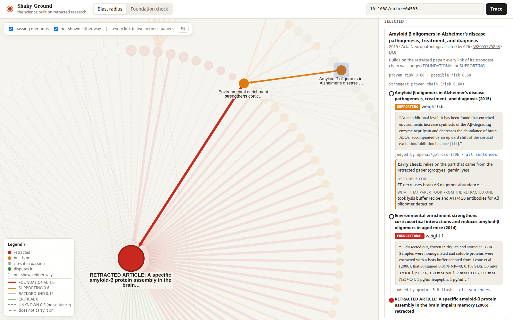

# Shaky Ground

**Finds the science built on retracted research, not just the papers that cite it.**

Shaky Ground loads a citation graph into FalkorDB from public data (Retraction Watch via Crossref, OpenAlex, Semantic Scholar). Each citation is weighted by how much the citing paper *relies* on the cited one, and the risk of a chain is the product of those weights, computed in Cypher. An agent decides which branches to explore and returns every answer with its evidence.

Graph Hacks: Context for AI Agents (WeMakeDevs × FalkorDB), **Track 01: Agents That Act on Connected Data**.

> Work in progress during the hackathon (Oct 15–18, 2026).

## What it found for one retracted paper

Lesné et al. 2006 (*Nature*, retracted 2024-06-24 over manipulated images), with its 2,767 loaded citers and the 4 papers the agent chose to expand:

- **45 papers build on it.** In each, every link of a chain was judged FOUNDATIONAL or SUPPORTING from the citing paper's own sentences. For 10 of them the strongest chain runs through another paper, and two models agreed that each later link relies on the part that came from Lesné.
- **2 of those 45 were retracted themselves:** *Cognitive effects of cell-derived and synthetically derived Aβ oligomers* (2010) and *Soluble α-Synuclein Is a Novel Modulator of Alzheimer's Disease Pathophysiology* (2012).
- **868 cite it only in passing, and 11 dispute it.**
- **3,304 are *not shown* either way,** because no citation sentence was available. They are never counted as clean.

Example of a chain that does *not* carry: Mainardi et al. 2014 used "a lysis buffer adapted from Lesne et al. (2006)". Papers citing Mainardi's Aβ-oligomer results build on Lesné through it. Papers citing its brain-wave results don't, and both models said so.

`python -m shaky.report 10.1038/nature04533` prints the full report, with the quoted sentence and the judging model for every link. The web UI shows the same graph:



[](https://github.com/aryangorde6/shaky-ground/actions/workflows/tests.yml)

## Run it locally

Needs Docker and [uv](https://docs.astral.sh/uv/).

```bash
# 1. FalkorDB, with a named volume so the graph survives restarts
docker compose up -d
# or, without Compose:
docker run -d --name shaky-falkordb -p 6379:6379 -p 3000:3000 \
  -v shaky-falkordb-data:/var/lib/falkordb/data falkordb/falkordb:latest

# 2. Settings: copy, then fill in your keys
cp .env.example .env

# 3. Python dependencies, then create the graph's indexes
uv sync
uv run python -m shaky.db

# 4. Load a paper, the papers it cites and the papers that cite it
#    (Lesné et al. 2006, Nature, retracted 2024: ~2,800 papers, ~30 OpenAlex credits)
uv run python -m shaky.load W2075481535
```

```bash
# 5. Evidence: the sentences in which each citer cites the paper (Semantic Scholar)
uv run python -m shaky.evidence W2075481535

# 6. Judge reliance from those sentences (Gemini: ~6 calls for Lesné's 754 sentences)
uv run python -m shaky.judge W2075481535 --provider gemini --batch 130

# 7. Risk for every paper, the carry check on second links (two models vote), then a check
#    of the stored numbers against brute force over every chain
uv run python -m shaky.carry W2075481535
uv run python -m shaky.risk W2075481535
```

```bash
# 8. Let the agent pick which papers to expand next, within a credit budget
uv run python -m shaky.agent 10.1038/nature04533 --rounds 2 --per-round 2 --credits 50 --judge groq

# 9. The blast-radius report, and a foundation check for any paper
uv run python -m shaky.report 10.1038/nature04533 --out data/reports/lesne.md
uv run python -m shaky.foundation 10.1016/j.neuroscience.2007.10.054

# 10. Median latency of the main queries, and the offline tests of the rules
uv run python -m shaky.bench W2075481535
uv run python -m unittest -v

# 11. The web UI (http://127.0.0.1:8000), and the MCP server for AI agents (stdio)
uv run python -m shaky.web
uv run python -m shaky.mcp_server
```

Every command takes a DOI (`10.…`, `doi:…`, `https://doi.org/…`), an OpenAlex ID or URL, or a PubMed ID (`pmid:…`). A title is refused rather than searched, because the closest match may be a different paper.

FalkorDB Browser: http://localhost:3000

Loads are idempotent (every write is a `MERGE` keyed by ID) and API responses are cached in `data/`, so a second run sends no requests and changes nothing.

## Graph model

```
(:Paper {id, doi, title, year, cited_by, type, is_review, venue, oa_url, retracted, refs,
         risk, risk_proven, risk_root, expanded_at})          // + label :Contaminated
(:Paper)-[:CITES {cls, reliance, contexts, intents, influential, evidence_src, evidence, why,
                  judged_by, judged_at,
                  carries, carry_root, carry_via, carry_votes, carry_evidence, carry_why, carry_by, carry_at}]->(:Paper)
(:Retraction {record_id, date, nature, reason, notice_doi})-[:RETRACTS]->(:Paper)
(:Investigation {id, mode, root, created_at, status, verdict, ...})-[:EXPLORED {round, reason, decided_by, citers, credits}]->(:Paper)
```

- `Paper.id` is the OpenAlex work ID. `refs` lists the IDs of every work the paper cites; a `CITES` edge exists only when both papers are loaded, so the rest of `refs` is the frontier still to explore.
- `CITES.cls` is how much the citing paper relies on the cited one: `FOUNDATIONAL` 1.0, `SUPPORTING` 0.6, `BACKGROUND` 0.15, `CRITICAL` 0, `UNKNOWN` 0.3 (no evidence yet). Every link from a retraction notice is `CRITICAL` (weight 0): a notice copies its paper's reference list, so it never counts as reliance, and it is not counted as disputing anything either.
- **How reliance is judged.** The model never picks a number. It reads only the citation sentences and answers yes/no questions: does the citing paper dispute it, fail to reproduce it, or mention the retraction? use its method or data? rely on its specific finding? Fixed rules turn the answers into a class (critical first; a statement backed by a list of 3+ references doesn't rest on any one of them), a table turns the class into a weight, and the code stores the deciding sentence verbatim as `CITES.evidence`, with `judged_by` and `judged_at`. A judged edge is never sent to the model again.
- `retracted` comes from OpenAlex or from a Retraction Watch notice. A paper with a `RETRACTS` edge is confirmed by Retraction Watch.
- No author names, institutions or countries are stored: Shaky Ground scores papers, never people.

## How risk is computed

**A chain's risk is the product of its reliance weights; a paper's risk is its riskiest chain of up to 3 citations.** All of it runs in Cypher. The model only answers questions about sentences.

| Class | The citing paper… | Weight |
|---|---|---|
| FOUNDATIONAL | uses its method, data or result | 1.0 |
| SUPPORTING | relies on its finding as evidence | 0.6 |
| BACKGROUND | mentions it in passing | 0.15 |
| CRITICAL | disputes it, fails to reproduce it, or reports the retraction | 0 |
| UNKNOWN | no citation sentence, or the sentences don't say | 0.3 |

**Two numbers per paper, so no answer claims more than its evidence.**
- `risk_proven` counts only links whose sentences were judged. UNKNOWN counts as 0.
- `risk` is the estimate the agent uses to decide where to dig, with UNKNOWN at 0.3. That is above the 0.20 average weight of the 1,012 judged links, so an unknown link is not underrated.

**Tiers, which follow exactly from the weights.** A paper *builds on* the retracted one when `risk_proven ≥ 0.2`. Two facts make that equivalent to "some chain has every link FOUNDATIONAL or SUPPORTING":
- a chain of 3 SUPPORTING links scores 0.6³ = 0.216 ≥ 0.2;
- any chain with a BACKGROUND link scores at most 0.15.

`risk.py` asserts this. A paper is in exactly one tier:
- *builds on* (label `:Contaminated`);
- *cites it in passing*: every proven chain has a BACKGROUND link;
- *not shown*: no chain has evidence on every link.

Separately, *disputes* counts the papers whose own link is CRITICAL.

**Dependence has to carry through the chain.** Mainardi et al. 2014 extracted proteins "with a lysis buffer adapted from Lesne et al. (2006)", so it builds on Lesné. A paper citing Mainardi for its brain-wave recordings relies on Mainardi, but on nothing Mainardi took from Lesné. So for every strong second link, a model gets two things: what the middle paper took from upstream (its own sentences), and how the next paper cites it. It writes down both, then answers whether they are the same part.
- **One model was not reliable enough.** Across four prompt and effort variants, gpt-oss-120b's count of *yes* answers on the same 31 links ranged from 0 to 30. Even the best variant marked citers of Mainardi's brain-wave results as carrying.
- **So two model families vote.** A link carries only if both say yes, and is cleared only if both say no.
- **Until a link is shown to carry, it counts at most as a passing mention.** Each vote is stored on the edge (`carry_votes`).

### Propagation: one hop per query

```cypher
MATCH (a:Paper)-[c:CITES]->(b:Paper)
WHERE b.risk_proven > 0 AND c.reliance > 0 AND c.cls <> 'UNKNOWN'
WITH a, max(b.risk_proven * CASE WHEN (b.id = $root OR (c.carry_root = $root AND c.carries = true))
                                 THEN c.reliance
                                 ELSE CASE WHEN c.reliance < $passing THEN c.reliance ELSE $passing END END) AS r
WHERE r > coalesce(a.risk_proven, 0.0)
SET a.risk_proven = r
RETURN count(a)
```

Risk flows backwards from the retracted paper (`risk_proven = 1.0`) along `CITES` edges. It runs 3 times, once per hop. Each run is one pass over the edges, so the cost grows with edges, not with the number of chains. The same query with UNKNOWN allowed at 0.3 gives `risk`.

### One paper's chain, with the evidence on every link

```cypher
MATCH p = (a:Paper {id: $id})-[:CITES*1..3]->(:Paper {id: $root})
WHERE all(c IN relationships(p) WHERE c.reliance > 0 AND c.cls <> 'UNKNOWN')
WITH p, reduce(r = 1.0, c IN relationships(p) | r * /* the same weight, with endNode(c) as b */) AS risk
ORDER BY risk DESC LIMIT 1
RETURN risk, nodes(p), relationships(p)
```

**The two queries must agree.** `python -m shaky.risk W2075481535` reruns the propagation, then scores *every* chain of up to 3 links with `reduce()`. It checks that both stored numbers match on every paper: on Oct 15, with 9,043 papers loaded, **0 mismatches** (`risk` on 4,217 papers, `risk_proven` on 913). The propagation took 0.22 s; the brute force took 131.7 s.

We first used `algo.SPpaths` with `cost = −ln(weight)`, so that the shortest path is the riskiest chain. It worked for fixed weights. But a `weightProp` is one stored number per edge, while the carry rule depends on which retracted paper is the root. So `reduce()` replaced it.

### Latency

`python -m shaky.bench W2075481535`, on a laptop with FalkorDB in Docker. Graph: 9,043 papers, 109,774 citations (Oct 15). Median of 20 runs:

| Query | Median |
|---|---|
| Propagate (writes both risk numbers for every paper, 3 hops) | 239 ms |
| Blast radius: top 50 papers proven to build on the root (reads `:Contaminated`) | 1.2 ms |
| Tiers: builds on / passing / not shown / disputes | 69 ms |
| One paper's riskiest chain with evidence (`reduce()`, a 2-link chain) | 18.1 ms |
| Agent frontier: 12 candidates to expand | 124 ms |
| Web UI view: 141 papers, each one's chain, the 592 links among them (first build, 5 runs; then cached at 1.3 ms) | 1.11 s |

## The agent

Each round, the agent gets the 12 riskiest papers whose own citers aren't loaded yet. For each it sees the risk, the proven risk, the class of its strongest link, the evidence sentence and the citation count. A model (Groq `gpt-oss-120b`) picks which ones to expand and says why. The code then:
- keeps only picks that were on the list and fit the OpenAlex credit budget;
- loads each pick's citers;
- fetches their citation sentences (Semantic Scholar) and judges them;
- runs the carry check and propagates again.

Every pick and its reason is stored as `(:Investigation)-[:EXPLORED {round, reason, decided_by, citers, credits}]->(:Paper)`, and the report prints them.

**The foundation check runs the other way: does a paper rest on retracted work?**
1. It loads the paper's references and theirs, to depth 2. Lookups by ID are free; batches cost 1 credit per 100.
2. It finds retracted ancestors, and fetches and judges sentences only for the links on chains to them.
3. It returns a verdict that is never stronger than the evidence:
   - `RESTS ON RETRACTED WORK`;
   - `NOT PROVEN`: a chain could reach the bar, but a link has no usable evidence;
   - `CITES RETRACTED WORK`;
   - `NO RETRACTED WORK FOUND`: with what could not be checked;
   - `CLEAN · DEPTH 2`: only when every reference to depth 2 was checked;
   - `NO DATA`.

## The web UI

`python -m shaky.web` serves one page (no build step) and a small JSON API over the same queries.

- **Blast radius.** The retracted paper sits at the centre. A paper sits on ring *k* when its strongest chain has *k* links, next to the paper the chain goes through, so every chain reads straight in. Colour is the tier (red retracted, orange builds on it, grey passing, green disputes it, dashed not shown). Link width is the weight; a dashed link has no sentence; a dotted one was shown not to carry the dependence on.
- **Click a paper** to see its chain, each link with its sentence, the model that judged it, and the carry check: what the paper uses the cited one for, and what that one took from the retracted paper. **Click a link** to see every sentence behind it.
- **Foundation check tab:** past checks with their chains, and a new check for any DOI.
- Built on the Python standard library's HTTP server and one static page with [Cytoscape.js](https://js.cytoscape.org) (pinned, with a subresource-integrity hash). Titles and sentences from papers are always set as text, never as HTML.
- `ALLOW_RUNS=0` makes it read only, for a public deployment: it then shows stored results and never spends API credits or model calls.

## The MCP server

`python -m shaky.mcp_server` lets any AI agent check a paper before citing it. It speaks the Model Context Protocol over stdio, also with the standard library only. Register it with an MCP client:

```json
{"mcpServers": {"shaky-ground": {"command": "uv",
  "args": ["run", "--directory", "/path/to/shaky-ground", "python", "-m", "shaky.mcp_server"]}}}
```

| Tool | What it returns |
|---|---|
| `check_foundations(paper, fresh=false)` | The verdict, each retracted paper within 2 links with its chain and quoted evidence, and the coverage. The stored check, unless `fresh` |
| `retraction_blast_radius(paper, limit=20)` | The tier counts, the papers that build on it (chain length, risk), the disputes, and the agent's reasons |
| `explain_chain(paper, retracted)` | The proven and the possible chain, each link with its class, weight, sentence, model and carry votes |

Bad input gets an error that says what is wrong (a title instead of an ID, a missing argument), never a guess.

## Limits

- **Most citations have no sentence to judge.** Semantic Scholar has citation sentences for 754 of the 2,767 loaded citations of Lesné et al. (27%). The rest stay UNKNOWN. They count as *not shown*, never as cleared.
- **Some publishers withhold reference lists** from Semantic Scholar's references endpoint. Sentences are fetched from the cited paper's citations instead, which works when that list is open.
- **OpenAlex reference lists include works it has since deleted.** For example, 23 of the 79 references of *Deep Residual Learning* return 404. Those can't be checked, so that paper gets `NO RETRACTED WORK FOUND`, not `CLEAN`.
- **"Retracted" means flagged by OpenAlex or matched by DOI to a Retraction Watch notice.** A reference without a DOI relies on the OpenAlex flag alone.
- **Models make mistakes.** Every judgment stores the sentence it rests on and the model that made it, so a person can check it. Judged links are never sent again. Bumping a prompt's `VERSION` re-judges.
- **Building on a retracted paper doesn't make a paper wrong.** Using its buffer recipe is not the same as relying on its manipulated images. The report says *depends on*, never *is wrong*. Next step: compare what was taken with what the retraction notice is about.
- **Risk is stored for one retracted paper at a time** (`risk_root`). A carry judgment is stored for one root per link.
- **Depth:** 3 citations downstream, 2 upstream, both to stay within the free API budgets.
- **Free tiers:**
  - Gemini: 20 requests a day.
  - Groq: 8,000 tokens a minute per model.
  - OpenAlex: 10,000 credits a day.
  - Semantic Scholar: 1 request a second.

## Prior art

- The **Feet of Clay Detector** (Problematic Paper Screener) flags papers whose reference lists include retracted papers.
- **Zotero** marks retracted papers in your own library.
- **scite** classifies individual citation statements as supporting, contrasting or mentioning.

Shaky Ground adds three things:
- it follows dependence *through* chains of citations;
- it counts a chain only when every link is shown, from the citing sentences, to rely on what came from the retracted work;
- it says *not shown* instead of *clean* when the evidence is missing.

## Data

Data: [Retraction Watch database](https://api.labs.crossref.org/data/retractionwatch) (via Crossref), [OpenAlex](https://openalex.org) and [Semantic Scholar](https://www.semanticscholar.org/product/api).

## Use of AI coding assistants

An AI coding assistant was used during development. Details to follow.
